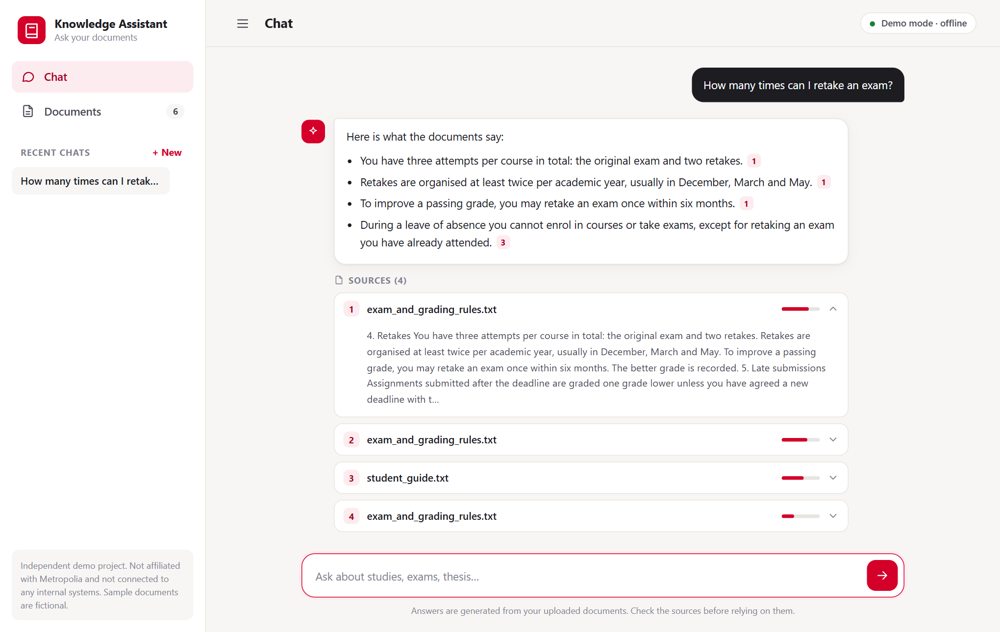
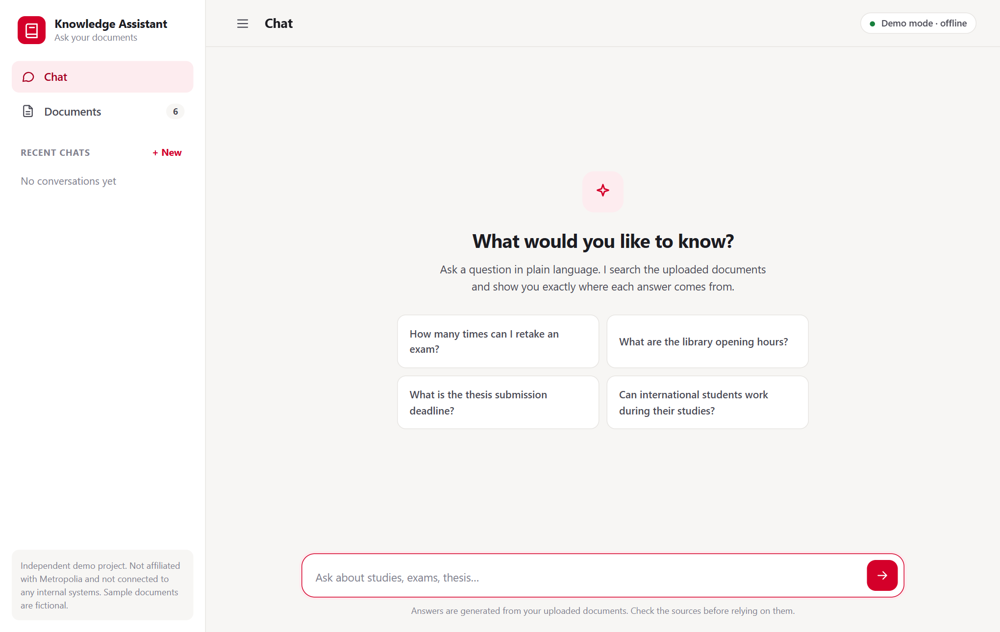
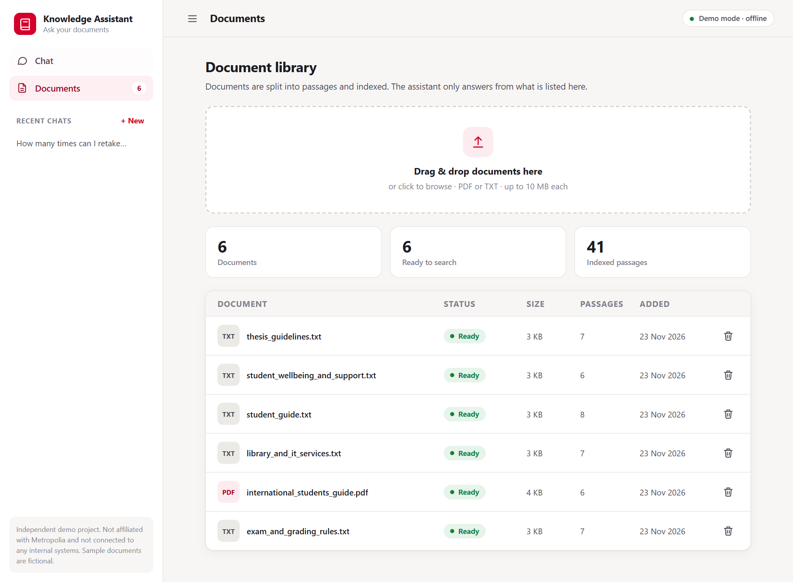
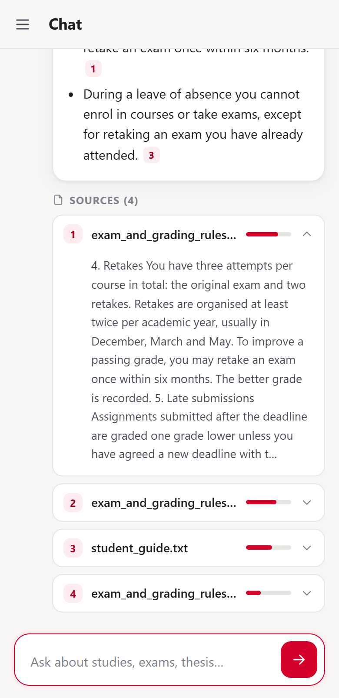
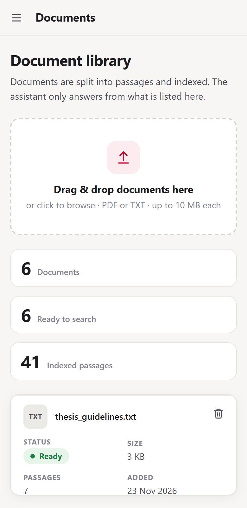

# Campus Knowledge Assistant

A RAG chat app that answers questions about university documents in plain language and **shows the passages each answer comes from**. Flask, SQLite, vanilla JS.

> Independent demo. Not affiliated with Metropolia and not connected to any internal systems. The sample documents are fictional.



| Empty state                        | Document library                 |
| ---------------------------------- | -------------------------------- |
|  |  |



## Features

- **Chat** with saved conversations and follow-up questions.
- **Sources on every answer**: `[1]` markers open a card with the file, the PDF page, a relevance bar and the retrieved excerpt.
- **PDF and TXT upload** (drag and drop). Files are split, embedded and indexed; duplicates are rejected; each file shows `ready` or `failed` with the reason.
- **Documents page** with counts, status and delete.
- **Runs offline.** Demo mode needs no API key. Point `.env` at OpenAI or any compatible API (Ollama, LM Studio) for generated answers.
- If nothing relevant is found, the app says so instead of inventing an answer.

## Run

Python 3.11+.

```bash
python -m venv .venv
# Windows:  .venv\Scripts\Activate.ps1
# macOS/Linux:  source .venv/bin/activate
pip install -r requirements.txt
python run.py
```

Open <http://127.0.0.1:5000>. Six sample documents are indexed on first start. Try _How many times can I retake an exam?_ or _What are the library opening hours?_

`.env` is optional; every setting has a default. To use a real model, copy `.env.example` and set `LLM_PROVIDER=openai` (see [DOCS.md](DOCS.md)).

```bash
pip install pytest && python -m pytest
```

Architecture, configuration, the API and design trade-offs are in [DOCS.md](DOCS.md).
